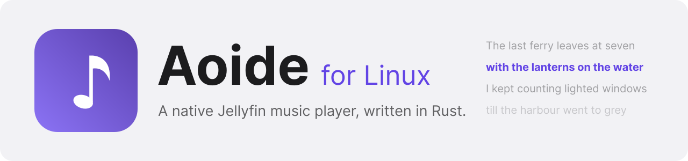
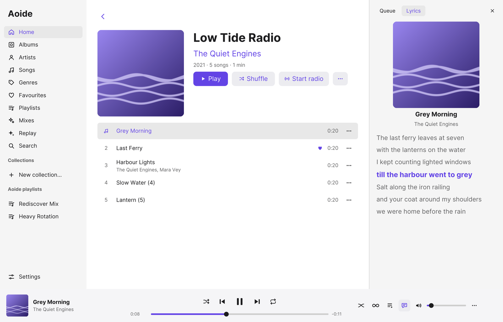
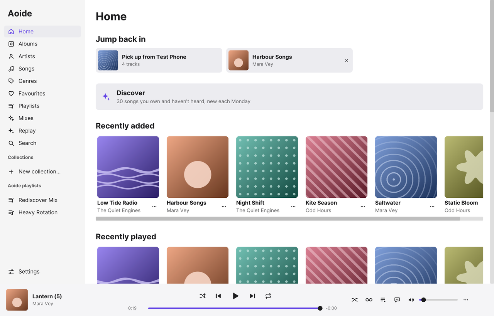
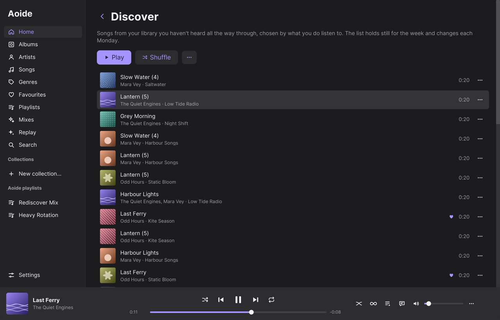
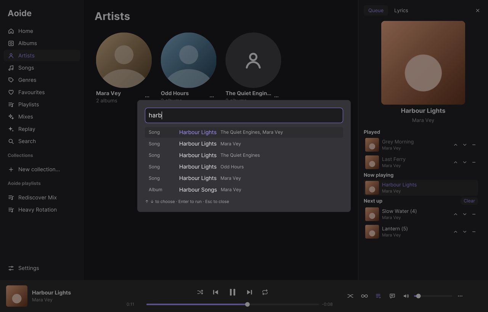
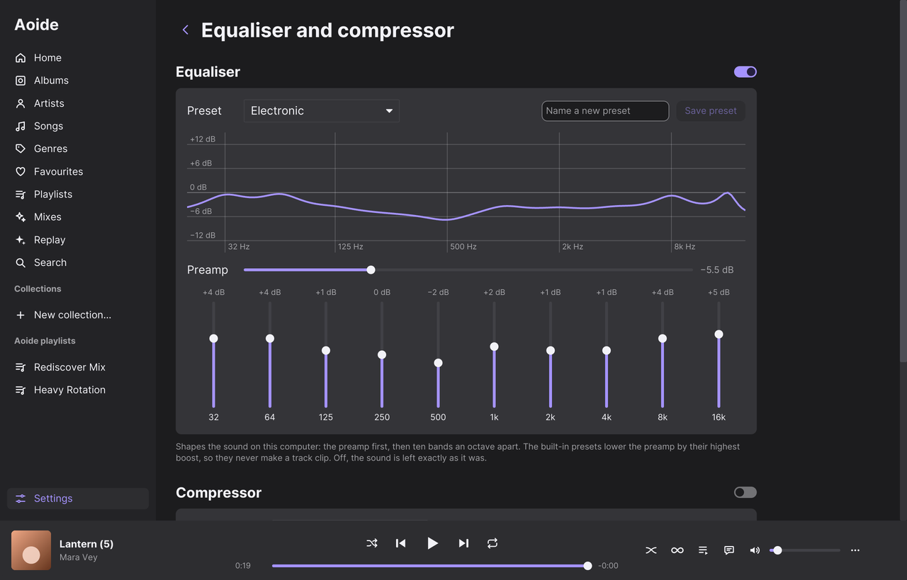

<div align="center">

<picture>
  <source media="(prefers-color-scheme: dark)" srcset="docs/assets/banner-dark.svg">
  <source media="(prefers-color-scheme: light)" srcset="docs/assets/banner-light.svg">
  
</picture>

**A music player for your own Jellyfin server, native on the Linux desktop, in sync with Aoide on iPhone.**

[](https://github.com/Virel0/aoide-linux/actions/workflows/ci.yml)
[](https://github.com/Virel0/aoide-linux/releases/latest)
[](LICENSE)
[](https://www.rust-lang.org)

[Install](#install) · [Features](#features) · [Privacy](#privacy) · [The Aoide family](#the-aoide-family) · [Building](#building) · [Security](SECURITY.md) · [Changelog](CHANGELOG.md)

<picture>
  <source media="(prefers-color-scheme: dark)" srcset="docs/screenshots/now-playing-dark.png">
  <source media="(prefers-color-scheme: light)" srcset="docs/screenshots/now-playing-light.png">
  
</picture>

</div>

Aoide plays the music on your Jellyfin server and keeps what is yours on your
computer: playlists, likes, taste flags and a play history. With the
[Aoide sidecar](https://github.com/Virel0/aoide-sidecar) plugin on the server,
all of that syncs with the iPhone app, so a playlist made on the phone is on the
desk, and a play at the desk counts on the phone.

It is written from scratch in Rust with [iced](https://iced.rs). No code from
Feishin or the Electron-based Aoide desktop app is copied here.

> **Status:** 0.1.0 is the first release, made for testing beside the Electron
> app. [TRACKER.md](TRACKER.md) lists every feature and how far it has been
> checked. Several desktop pieces (MPRIS, the tray, the keyring) have run in CI
> or on macOS but not yet on a Linux desktop.

## Features

<table>
<tr>
<td width="50%" valign="top">

### Library
- **Home**: jump back in to the last albums and playlists, or pick up what another device was playing; shelves of recently added, played and released, most played, random albums and genres
- Albums, artists, songs, genres, favourites, and **collections**: saved filters by genre, year, tag and favourite
- Search as you type; **search by description** through OpenRouter once you add a key
- **Command palette** on Ctrl+K: every screen, the player's controls, and songs, albums and artists
- Get info on any song: format, bit rate, sample rate, bit depth, size, plays

### Playback
- Native decoding with symphonia: FLAC, ALAC, MP3, AAC, Vorbis, WAV, AIFF
- **Sample-exact gapless** joins for WAV, AIFF, FLAC and ALAC
- Crossfade (8 s, or 4 s between songs at the same tempo) and Keep albums whole
- Level volume to −18 LUFS from the sidecar's measurements, ReplayGain tags otherwise; Skip silence
- Ten-band equaliser with 14 presets, a compressor, an output device picker, optional transcoding
- Sleep timer, private listening, a full-screen player with a visualiser

### Lyrics
- Synced lyrics from Jellyfin: follow along, click a line to seek, adjust the timing
- Lyrics from LRCLIB when the server has none
- Translation by your own LibreTranslate server
- Romaji and furigana for Japanese lyrics

</td>
<td width="50%" valign="top">

### Playlists and history
- **Aoide playlists** in folders, with notes and covers, shared with other people on the server
- Jellyfin playlists: create, edit, reorder, change the cover
- **Smart playlists** evaluated when opened; Rediscover Mix and Heavy Rotation built in
- Import a playlist from a Spotify link or a CSV file, and see what your library lacks
- **Replay**: this month, this year or all time, from the local play history
- Finish rates on albums and artists
- Taste flags: *Not interested* keeps a song out of mixes and radio; *Don't count plays* keeps it out of the history

### Discovery
- **Infinity** keeps the queue going with songs your server picks, or whole albums
- **Discover**: 30 songs you own and haven't heard through, new each Monday
- Radio from any song, album, artist, genre or playlist
- Mixes from a described mood, through OpenRouter

### Sync with the sidecar
- Playlists, folders, likes, taste flags and the play history, between the Linux app and the iPhone app
- Hand the queue from one device to another

### Desktop
- MPRIS media controls, so the media keys work, and a tray icon
- A second launch brings the open window forward; no sleep while music plays
- Light, dark or system appearance, with six accent colours
- Discord Rich Presence, off until you turn it on
- A notice when a newer release is out

</td>
</tr>
</table>

<table>
<tr>
<td width="50%"></td>
<td width="50%"></td>
</tr>
<tr>
<td width="50%"></td>
<td width="50%"></td>
</tr>
</table>

The screenshots show a stand-in test server with made-up artists, albums and
lyrics.

## The Aoide family

- **[Aoide for iPhone](https://github.com/Virel0/aoide)**: the iOS app, in SwiftUI, with CarPlay and Siri.
- **Aoide for Linux** (this repository): the desktop app, in Rust.
- **[Aoide sidecar](https://github.com/Virel0/aoide-sidecar)**: the Jellyfin plugin both apps sync through. Optional: without it, the apps still play music and keep playlists on the device.

Aoide was one of the three original Muses in Greek myth; the name means "song".

## Install

Every [release](https://github.com/Virel0/aoide-linux/releases/latest) is built
by GitHub Actions for x86_64. The app installs as the command `aoide-linux`, so
it can sit beside the Electron app.

### Arch Linux and derivatives (pacman repository)

Add the repository to `/etc/pacman.conf`:

```ini
[aoide-linux]
SigLevel = Optional TrustAll
Server = https://github.com/Virel0/aoide-linux/releases/latest/download
```

Then install it, and from then on it updates with the rest of the system:

```sh
sudo pacman -Syu aoide-linux
```

Releases are not signed yet, which is why `SigLevel` is relaxed. Each release
carries `SHA256SUMS` files, and [docs/releases.md](docs/releases.md) has the
stricter lines to use once a release key exists. Optional packages: a Secret
Service provider such as GNOME Keyring or KWallet, which keeps you signed in
between launches, and `noto-fonts-cjk` for Japanese, Chinese and Korean text.

### Flatpak

```sh
curl -LO https://github.com/Virel0/aoide-linux/releases/latest/download/aoide-linux.flatpak
flatpak install --user aoide-linux.flatpak
flatpak run io.github.Virel0.Aoide.Linux
```

The bundle uses the freedesktop 26.08 runtime from Flathub. It does not update
itself: install the next release's bundle the same way. The Flatpak builds in
CI but has not yet been run on a desktop.

### AppImage and deb

Download `aoide-linux-<version>-x86_64.AppImage` or
`aoide-linux_<version>_amd64.deb` from the
[latest release](https://github.com/Virel0/aoide-linux/releases/latest). Both
need glibc 2.35 or later (Ubuntu 22.04, Debian 12 and newer). The AppImage
bundles no libraries: it uses the system's ALSA, D-Bus, and Wayland or X11.

```sh
sha256sum --check --ignore-missing SHA256SUMS-appimage-deb
chmod +x aoide-linux-*-x86_64.AppImage && ./aoide-linux-*-x86_64.AppImage
sudo apt install ./aoide-linux_*_amd64.deb
```

## Using it

1. Open **Aoide** from the app menu, or run `aoide-linux`.
2. Type your server's address, or press **Find servers on this network**. Home
   addresses (`jellyfin.local`, a local network IP) connect over plain HTTP;
   anything else uses HTTPS.
3. Sign in with your Jellyfin username and password.

Ctrl+K opens the command palette from anywhere. Tab moves between fields and
Escape closes what is on top.

## Privacy

Aoide has no account of its own and no analytics. It talks to your server, and
to other services only for the features below.

| Where | What is sent | When |
|---|---|---|
| Your Jellyfin server | Sign-in, library requests, streams, playback reports | Always; *Private listening* stops the reports |
| The Aoide sidecar, on the same server | The sync log, the queue for handoff, requests for measurements, Infinity and Discover | When the plugin is installed |
| [LRCLIB](https://lrclib.net) | Title, first artist, album and length of a song your server has no lyrics for | On by default; Settings → Lyrics → *Find lyrics on the internet* |
| Your LibreTranslate server | The lyric lines, your language and the key | Only when you set a server and turn on Translate |
| [OpenRouter](https://openrouter.ai) | The phrase you typed, or a mix's description, with your library's genre names | Only with a key set, and only when you press the button |
| Discord, through its local socket | The song and artist; the cover's address only if it is public HTTPS | Only while Rich Presence is on |
| GitHub's API | One unauthenticated request for the latest release, with a fixed user agent, at most once a day | On by default; Settings → System → Updates → *Check for updates* |
| Spotify | A request for the public playlist page you paste | Only when you import a playlist |

What stays on the computer: the sign-in token and any API keys in the system
keyring (the Secret Service, or the Secret portal inside the Flatpak); settings
in `~/.config/aoide/config.json`; the play history, playlists, taste flags and
sync log in `~/.local/share/aoide/aoide.sqlite`; artwork and 30 days of LRCLIB
answers in `~/.cache/aoide`. [SECURITY.md](SECURITY.md) has the details.

## Building

```sh
cargo run -p aoide-app
```

Rust 1.98 or later. Linux needs the ALSA and D-Bus development headers
(`alsa-lib` and `dbus` on Arch, `libasound2-dev` and `libdbus-1-dev` on Debian
and Ubuntu). The default build includes furigana, which fetches the IPADIC
dictionary at build time and adds about 48 MB to the binary.

The checks CI runs:

```sh
cargo fmt --all --check
cargo clippy --workspace --all-targets -- -D warnings
cargo test --workspace
```

[CONTRIBUTING.md](CONTRIBUTING.md) has the rest: the D-Bus and keyring tests,
and the packaging checks.

### Code layout

| Crate | What it holds |
|---|---|
| `aoide-jellyfin` | Jellyfin HTTP client |
| `aoide-lyrics` | Internet lyrics (LRCLIB) for tracks the server has none for, and LRC parsing |
| `aoide-sidecar` | Aoide sidecar client: sync, Infinity, Discover, measurements |
| `aoide-store` | Local SQLite store: history, playlists, taste flags, op log |
| `aoide-audio` | Decoding, output, gapless, crossfade, loudness |
| `aoide-mpris` | The Linux desktop: MPRIS media controls, tray icon, single instance, sleep inhibit |
| `aoide-integrations` | Services outside the server: Discord Rich Presence, OpenRouter (search by description, mixes), lyric translation, update notice |
| `aoide-app` | The iced application |

What is ported from the Electron app, and what is still to come, is in
[TRACKER.md](TRACKER.md). Release signing and checksums are in
[docs/releases.md](docs/releases.md), and the LibreTranslate setup in
[docs/translation.md](docs/translation.md).

## Licence

GPL-3.0-or-later; see [LICENSE](LICENSE). The bundled Inter font
(`crates/aoide-app/fonts`) is under the SIL Open Font License 1.1; its licence
is beside it.
